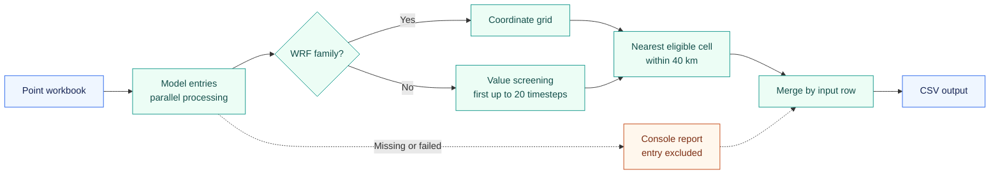
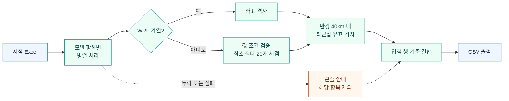

<a id="top"></a>

# Multi-Model Grid Validator

<p align="center">
  
</p>

<p align="center">
  <strong>Time-series value screening and nearest-grid matching</strong><br />
  Ocean · Wave · Atmospheric numerical models
</p>

<p align="center">
  <a href="#en-validation"></a>
  <a href="#en-data"></a>
  <a href="#en-validation"></a>
  <a href="#english"></a>
</p>

<p align="center">
  <a href="#english"><strong>English</strong></a> ·
  <a href="#한국어"><strong>한국어</strong></a> ·
  <a href="#en-quick-start">Quick start</a> ·
  <a href="#en-methodology">Workflow</a> ·
  <a href="#en-validation">Validation</a> ·
  <a href="tests/test_matching.py">Tests</a>
</p>

| Search radius | Screening window | Model entries | Export |
| :---: | :---: | :---: | :---: |
| **40 km** | **First up to 20 timesteps**¹ | **15 configurations** | **CSV · euc-kr** |

¹ WRF entries use coordinate-based matching only. The test badge records a dated local run.

---

## English

[About](#en-about) · [Highlights](#en-highlights) · [Methodology](#en-methodology) · [Data contract](#en-data) · [Files](#en-contents) · [Quick start](#en-quick-start) · [Models](#en-models) · [Output](#en-output) · [Validation](#en-validation) · [Notes](#en-notes)

<a id="en-about"></a>

### About

This project automates the assignment of numerical model grid cells to geographic service locations. It reads longitude and latitude from an Excel workbook, identifies eligible cells within **40 km** of each location, and exports the nearest eligible cell's grid indices and a first-timestep sample value to CSV.

The workflow supports point-based marine and meteorological services where a spatially close cell may contain values that fail the screening rule over time. For non-WRF models, eligibility combines a spatial distance constraint with a value check across the **first 20 available timesteps**, or all available timesteps when fewer than 20 are present.

Developed as the individual development project **“다중 수치모델 3차원 정상값 검증 및 최근접 격자 자동매칭 알고리즘 개발”** (three-dimensional value validation and automated nearest-grid matching across multiple numerical models).

> [!NOTE]
> **Scope of “3D”:** the implementation operates on `(time, y, x)` arrays. Here, three dimensions mean time and two horizontal grid axes. Vertical coordinates such as depth or altitude, and `(time, z, y, x)` arrays, are outside the current implementation.

<a id="en-highlights"></a>

### Highlights

| Capability | What it provides |
| --- | --- |
| **Temporal screening** | A non-WRF cell must pass the value rule at every inspected timestep |
| **Spatial matching** | Haversine distance selects the nearest eligible cell within 40 km |
| **Multiple models** | 15 processing entries, including five CWW3 domains |
| **WRF handling** | Coordinate-based selection for WRF, WRFdm1, and WRFdm2 |
| **Parallel processing** | Model entries run in a process pool; input row order is preserved |
| **Partial results** | Successful model results are retained when other entries fail |
| **Tabular export** | Original columns plus model indices and first-timestep values |

<a id="en-methodology"></a>

### Methodology



1. Read service locations from `포인트.xlsx`.
2. Resolve each model's file and coordinate, value, and time-variable mappings.
3. Construct a horizontal grid from one-dimensional latitude/longitude arrays, or use existing two-dimensional coordinate arrays.
4. For non-WRF models, intersect cell-level eligibility masks across the first `min(20, number_of_timesteps)` timesteps.
5. Compute the Haversine distance from each location to every grid cell.
6. Select the cell with the smallest distance among eligible cells at or within 40 km.
7. Merge model results with the input table and write `포인트지정.csv`.

Selection is performed independently for each location and model entry. The result is a **nearest eligible cell assignment**. The script does not interpolate values, compare forecasts with observations, align timestamps between models, or evaluate forecast skill. If eligible cells have exactly equal computed distances, NumPy's array traversal order determines the selected index.

<a id="en-data"></a>

### Data contract

| Component | Expected structure | Processing behavior |
| --- | --- | --- |
| Point workbook | `포인트.xlsx`, with numeric `lon` and `lat` columns in degrees | Existing columns and row order are preserved |
| Coordinate arrays | One-dimensional latitude/longitude axes, or compatible two-dimensional grids | One-dimensional axes are expanded with `meshgrid` |
| Non-WRF value array | `(time, y, x)`, consistent with the horizontal grid | All inspected timesteps must pass the screening rule |
| WRF coordinates | Latitude/longitude grid | Values and time variables are not inspected |
| Model files | Locally supplied NetCDF files under `model/` | Missing or failed entries are excluded from the merged result |

Users should check coordinate units, geographic ranges, missing coordinates, grid compatibility, and variable dimension order before execution. The script does not provide comprehensive input-schema or coordinate-reference-system validation. No coordinate transformation or unit conversion is performed. Timesteps are inspected by array position; elapsed duration depends on the source dataset.

<a id="en-contents"></a>

### Repository contents

| Path | Purpose |
| --- | --- |
| `지점_격자_자동매칭.py` | Model configuration, screening, distance calculation, parallel matching, and CSV export |
| `포인트.xlsx` | Current input workbook: 19 locations, with `lon` and `lat` columns |
| `실행방법.txt` | Original usage guide, updated with installation instructions |
| `결과물 예시/` | Historical input workbook and output CSV for format reference |
| `(신규융합정보) 다중 수치모델 3차원 정상값 검증 및 최근접 격자 자동매칭 알고리즘 개발_이상학.pdf` | Project background and presentation material, in Korean |
| `requirements.txt` | Third-party Python dependencies |
| `tests/test_matching.py` | Regression checks using synthetic NetCDF datasets |
| `model/` | Local model data; excluded from version control |

<a id="en-quick-start"></a>

### Quick start

The original usage guide specifies **Python 3.10**. The recorded regression run used Python 3.13.9; its environment is documented under Validation.

Create an environment:

```bash
python -m venv .venv
```

Windows PowerShell:

```powershell
.\.venv\Scripts\Activate.ps1
python -m pip install -r requirements.txt
python "지점_격자_자동매칭.py"
```

<details>
<summary>macOS / Linux commands</summary>

```bash
source .venv/bin/activate
python -m pip install -r requirements.txt
python "지점_격자_자동매칭.py"
```

</details>

Before running, populate `포인트.xlsx`, create `model/` beside the script, and supply the relevant NetCDF files. File paths are resolved relative to the **script directory**. `openpyxl` is required for `.xlsx` input; `multiprocessing` is part of the Python standard library.

After running, inspect both the output columns and console messages. A CSV can be produced even when every model entry has been excluded.

<a id="en-models"></a>

### Model configuration

Edit `model_infos` in the script to change file or variable mappings. Every listed file is expected under `model/`.

<details>
<summary><strong>View all 15 model configurations</strong></summary>

| Entry | NetCDF file | Latitude / longitude | Value variable | Time variable |
| --- | --- | --- | --- | --- |
| YES3K | `YES3K_2023041900.nc` | `lat_rho` / `lon_rho` | `temp` | `ocean_time` |
| WW3 | `WW3_2023041800.nc` | `Latitude` / `Longitude` | `Hsig` | `ocean_time` |
| CWW3_1 | `CWW3_2023041800.nc` | `lat1_dajn` / `lon1_dajn` | `hsig1_dajn` | `time` |
| CWW3_2 | `CWW3_2023041800.nc` | `lat2_gwju` / `lon2_gwju` | `hsig2_gwju` | `time` |
| CWW3_3 | `CWW3_2023041800.nc` | `lat3_jeju` / `lon3_jeju` | `hsig3_jeju` | `time` |
| CWW3_4 | `CWW3_2023041800.nc` | `lat4_busn` / `lon4_busn` | `hsig4_busn` | `time` |
| CWW3_5 | `CWW3_2023041800.nc` | `lat5_gawn` / `lon5_gawn` | `hsig5_gawn` | `time` |
| RWW3 | `RWW3_2023041800.nc` | `lat1_dajn` / `lon1_dajn` | `hsig1_dajn` | `time` |
| MOHID2k | `Mohid2k_2023041712.nc` | `lat_rho` / `lon_rho` | `temp` | `ocean_time` |
| MOHID300 | `L4_OC_2022122912.nc` | `lat` / `lon` | `temp` | `ocean_time` |
| SWAN2k | `L2_WA_2024050112.nc` | `lat` / `lon` | `Hs` | `tim` |
| SWAN300 | `L4_WA_2022123012.nc` | `lat` / `lon` | `Hs` | `tim` |
| WRF | `WRF_20230427.nc` | `lat_rho` / `lon_rho` | Not inspected | Not used |
| WRFdm1 | `wrfdm1_20240627_20240706.nc` | `lat_rho` / `lon_rho` | Not inspected | Not used |
| WRFdm2 | `wrfdm2_20240627_20240706.nc` | `lat_rho` / `lon_rho` | Not inspected | Not used |

</details>

For non-WRF entries, the script first checks the configured time variable or dimension, then falls back to `ocean_time`, `time`, and `tim`. New mappings must conform to the supported array layouts.

<a id="en-output"></a>

### Output specification

| Column | Meaning |
| --- | --- |
| Original input columns | Preserved location attributes |
| `<MODEL>_X` | Zero-based column index of the selected cell |
| `<MODEL>_Y` | Zero-based row index of the selected cell |
| `result_<MODEL>` | Value at the selected cell's first timestep; omitted for WRF entries |

For a `(time, y, x)` value array, the sample corresponds to `values[0, <MODEL>_Y, <MODEL>_X]`. Its units are inherited from the source variable; the CSV does not include unit metadata.

**Missing-result interpretation:** when a model is processed but a location has no eligible cell within the radius, its result fields contain `NaN`, written as empty CSV fields. When an entire model entry is unavailable or fails, its result columns are absent. These two cases have different meanings and should remain distinct in downstream analysis.

The output contains the original point coordinates and selected grid indices. Selected-cell coordinates, distances, and detailed rejection reasons are not exported.

<a id="en-validation"></a>

### Validation

Run the regression suite without supplying real model data:

```bash
python -m unittest discover -s tests -v
```

**Recorded result: 11 synthetic-data tests passed on 2026-10-14.**

<details>
<summary><strong>Recorded validation environment</strong></summary>

| Environment | Recorded version |
| --- | --- |
| Operating system | Windows |
| Python | 3.13.9 |
| NumPy | 2.5.4 |
| pandas | 3.0.6 |
| netCDF4 | 1.7.4 |
| openpyxl | 3.1.5 |

</details>

Coverage includes known-distance checks, radius exclusion, rejection of an invalid nearest cell, eligibility across multiple timesteps, the 20-timestep limit, shorter time series, one- and two-dimensional coordinates, WRF exceptions, missing and unreadable files, unsupported value dimensions, and input-only output when all models are missing. A regression check also documents the current value rule's handling of positive infinity.

NumPy-related `DeprecationWarning` messages occurred during netCDF4 array writes; the tests passed. Dependency versions are not pinned, so the environment table records the tested configuration rather than guaranteeing identical behavior across installations.

> [!IMPORTANT]
> **Evidence boundaries:** the full real-model workflow was not rerun during repository preparation. The tests establish behavior for the synthetic cases; they do not establish operational accuracy, forecast skill, or throughput on production datasets.

The historical sample CSV contains **17 rows and 44 columns**, and its paired workbook contains 17 rows. The current root workbook contains **19 rows and 2 columns**. The historical CSV is therefore not a rerun of the current input. Each sample-output row has missing values for some models, so the example demonstrates the output format rather than complete matching coverage.

The presentation's reported runtime of approximately six minutes for 1,000 locations is a historical claim and was not remeasured during repository preparation.

<a id="en-notes"></a>

### Notes

> [!IMPORTANT]
> Review the value rule and source metadata before using the selected cells in an operational service.

**Value screening semantics.** `is_normal_value()` excludes NaN and zero, then rejects values whose string representation contains `+` or `-`, or equals `nan`, `NaN`, or `None`. Negative values and scientific notation containing an exponent sign can therefore be rejected. Positive infinity can pass. This is an implementation-specific eligibility rule; it does not establish a variable's physical validity. Review it against the intended variable, units, and valid range before applying the results.

**NetCDF missing data.** General handling of masked arrays and `_FillValue` conventions has not been comprehensively validated. Empty time axes are not guaranteed to produce a successful result. Only the first inspected timesteps contribute to eligibility.

**Resource use.** Non-WRF value variables are loaded in full before the first 20 timesteps are inspected. Parallel execution can increase peak memory use, and CWW3 domain entries read the same file independently. There is no recorded production memory benchmark.

**Operational behavior.** The 40 km radius and 20-timestep limit are fixed in the code; no CLI parameters are provided. Model errors are written to the console because the `missing_models.txt` write block is commented out. Input text that cannot be encoded as `euc-kr` can cause CSV export to fail. Check model-column presence and console messages before consuming an output.

**Data management.** Model binaries and generated root-level outputs are excluded by `.gitignore`; curated example files remain versioned. Supply model data locally with the appropriate usage rights.

**Future improvements.** Candidate work includes variable-specific valid ranges, explicit finite-value and mask handling, configurable radius and time windows, sliced reads, selected-cell coordinates and distances, structured processing reports, vertical-level support, and result visualization. These are proposed extensions.

[Back to top](#top) · [한국어 문서](#한국어)

---

## 한국어

[개요](#ko-about) · [주요 기능](#ko-highlights) · [처리 방법](#ko-methodology) · [입력 요건](#ko-data) · [파일](#ko-contents) · [실행](#ko-quick-start) · [모델](#ko-models) · [출력](#ko-output) · [검증](#ko-validation) · [유의점](#ko-notes)

<a id="ko-about"></a>

### About · 프로젝트 개요

이 프로젝트는 지점 기반 해양·기상 서비스에 사용할 수치모델 격자를 자동으로 지정합니다. Excel에서 지점별 위·경도를 읽고, 각 지점의 **반경 40km** 안에서 조건을 통과한 최근접 격자를 선택해 격자 인덱스와 첫 시점의 표본값을 CSV로 제공합니다.

공간적으로 가까운 격자라도 시간에 따라 결측이나 값 조건 위반이 발생할 수 있습니다. WRF 계열을 제외한 모델은 **최초 최대 20개 타임스텝**에서 모두 값 조건을 통과한 격자만 후보로 선정합니다. 전체 시점이 20개 미만이면 존재하는 시점을 모두 검사합니다.

**「다중 수치모델 3차원 정상값 검증 및 최근접 격자 자동매칭 알고리즘 개발」** 개인 목표 프로젝트로 개발했습니다.

> [!NOTE]
> **3차원의 의미:** 현재 구현은 `(time, y, x)` 배열을 처리합니다. 시간과 두 수평 격자 축을 함께 검토하는 방식이며, 수심·고도 등 수직 좌표를 포함한 `(time, z, y, x)` 배열은 지원하지 않습니다.

<a id="ko-highlights"></a>

### Highlights · 주요 기능

| 기능 | 제공 내용 |
| --- | --- |
| **시계열 검증** | WRF 외 격자는 검사하는 모든 시점에서 값 조건 통과 필요 |
| **공간 매칭** | Haversine 거리로 40km 안의 최근접 유효 격자 선택 |
| **다중 모델** | CWW3의 5개 영역을 포함한 15개 처리 항목 |
| **WRF 처리** | WRF, WRFdm1, WRFdm2는 좌표 기준으로 선택 |
| **병렬 실행** | 모델별 프로세스 풀 처리, 입력 행 순서 유지 |
| **부분 결과** | 다른 항목이 실패해도 성공한 모델 결과 유지 |
| **표 형식 출력** | 기존 열에 격자 인덱스와 첫 시점 값 추가 |

<a id="ko-methodology"></a>

### Methodology · 처리 방법



1. `포인트.xlsx`에서 대상 지점 정보를 읽습니다.
2. 모델별 파일과 좌표·값·시간 변수 설정을 확인합니다.
3. 1차원 위·경도 축은 수평 격자로 확장하고, 2차원 좌표 격자는 그대로 사용합니다.
4. WRF 외 모델은 최초 `min(20, 전체 시점 수)`개 시점의 조건을 모두 만족하는 격자 마스크를 생성합니다.
5. 각 지점에서 모델 격자까지의 Haversine 거리를 계산합니다.
6. 40km 이내 유효 후보 중 거리 최솟값에 해당하는 격자를 선택합니다.
7. 모델별 결과를 입력 표와 결합해 `포인트지정.csv`로 저장합니다.

매칭은 지점·모델 항목별로 독립 수행합니다. 산출물은 **값 조건을 통과한 최근접 격자의 지정 결과**입니다. 보간, 관측값과의 비교, 모델 간 시간 정렬, 예측 성능 평가는 수행하지 않습니다. 계산된 거리가 정확히 같은 후보가 여러 개이면 NumPy 배열 탐색 순서에 따라 선택합니다.

<a id="ko-data"></a>

### Data contract · 입력 데이터 요건

| 구성 요소 | 요구 구조 | 처리 방식 |
| --- | --- | --- |
| 지점 Excel | `포인트.xlsx`, 도 단위의 숫자형 `lon`, `lat` 열 | 기존 열과 행 순서 유지 |
| 좌표 배열 | 1차원 위·경도 축 또는 서로 호환되는 2차원 격자 | 1차원 축은 `meshgrid`로 확장 |
| WRF 외 값 배열 | 수평 격자와 일치하는 `(time, y, x)` | 검사하는 모든 시점에서 조건 통과 필요 |
| WRF 좌표 | 위·경도 격자 | 값 변수와 시간 변수는 검사하지 않음 |
| 모델 파일 | `model/` 아래에 직접 준비한 NetCDF | 누락·실패 항목은 통합 결과에서 제외 |

실행 전 좌표 단위·범위·결측, 격자 크기의 일치 여부, 변수 차원 순서를 확인해야 합니다. 코드에는 입력 스키마와 좌표계를 포괄적으로 검증하는 기능이 없습니다. 좌표 변환과 단위 변환도 수행하지 않습니다. 시간 검사는 배열 순서 기준이므로, 검사 구간의 실제 지속 시간은 원본 자료의 시간 간격에 따라 달라집니다.

<a id="ko-contents"></a>

### Repository contents · 저장소 구성

| 경로 | 용도 |
| --- | --- |
| `지점_격자_자동매칭.py` | 모델 설정, 값 검증, 거리 계산, 병렬 매칭 및 CSV 출력 |
| `포인트.xlsx` | 현재 입력 19개 지점, `lon`, `lat` 열 |
| `실행방법.txt` | 패키지 설치 안내를 보완한 기존 실행 문서 |
| `결과물 예시/` | 출력 형식 참고용 기존 입력 Excel과 결과 CSV |
| `(신규융합정보) 다중 수치모델 3차원 정상값 검증 및 최근접 격자 자동매칭 알고리즘 개발_이상학.pdf` | 프로젝트 배경 및 설명자료 |
| `requirements.txt` | 외부 Python 패키지 목록 |
| `tests/test_matching.py` | 합성 NetCDF 기반 회귀 검증 |
| `model/` | 직접 준비하는 모델 데이터, Git 추적 제외 |

<a id="ko-quick-start"></a>

### Quick start · 실행 방법

기존 실행 안내의 기준은 **Python 3.10**입니다. 기록된 회귀 검증은 Python 3.13.9에서 수행했으며 상세 환경은 Validation에 명시했습니다.

가상환경 생성:

```bash
python -m venv .venv
```

Windows PowerShell:

```powershell
.\.venv\Scripts\Activate.ps1
python -m pip install -r requirements.txt
python "지점_격자_자동매칭.py"
```

<details>
<summary>macOS / Linux 실행 명령</summary>

```bash
source .venv/bin/activate
python -m pip install -r requirements.txt
python "지점_격자_자동매칭.py"
```

</details>

실행 전에 `포인트.xlsx`를 작성하고 스크립트 옆에 `model/` 폴더를 만든 뒤 필요한 NetCDF 파일을 넣습니다. 파일 경로는 **스크립트가 있는 폴더**를 기준으로 해석합니다. `.xlsx` 입력에는 `openpyxl`이 필요하고, `multiprocessing`은 Python 표준 라이브러리이므로 별도 설치하지 않습니다.

실행 후 출력 열과 콘솔 안내를 함께 확인하십시오. 모든 모델이 제외되어도 CSV는 생성될 수 있습니다.

<a id="ko-models"></a>

### Model configuration · 모델 설정

스크립트의 `model_infos`에서 파일명과 변수명을 수정합니다. 아래 파일은 모두 `model/` 아래에 둡니다.

<details>
<summary><strong>전체 15개 모델 설정 보기</strong></summary>

| 항목 | NetCDF 파일 | 위도 / 경도 변수 | 값 변수 | 시간 변수 |
| --- | --- | --- | --- | --- |
| YES3K | `YES3K_2023041900.nc` | `lat_rho` / `lon_rho` | `temp` | `ocean_time` |
| WW3 | `WW3_2023041800.nc` | `Latitude` / `Longitude` | `Hsig` | `ocean_time` |
| CWW3_1 | `CWW3_2023041800.nc` | `lat1_dajn` / `lon1_dajn` | `hsig1_dajn` | `time` |
| CWW3_2 | `CWW3_2023041800.nc` | `lat2_gwju` / `lon2_gwju` | `hsig2_gwju` | `time` |
| CWW3_3 | `CWW3_2023041800.nc` | `lat3_jeju` / `lon3_jeju` | `hsig3_jeju` | `time` |
| CWW3_4 | `CWW3_2023041800.nc` | `lat4_busn` / `lon4_busn` | `hsig4_busn` | `time` |
| CWW3_5 | `CWW3_2023041800.nc` | `lat5_gawn` / `lon5_gawn` | `hsig5_gawn` | `time` |
| RWW3 | `RWW3_2023041800.nc` | `lat1_dajn` / `lon1_dajn` | `hsig1_dajn` | `time` |
| MOHID2k | `Mohid2k_2023041712.nc` | `lat_rho` / `lon_rho` | `temp` | `ocean_time` |
| MOHID300 | `L4_OC_2022122912.nc` | `lat` / `lon` | `temp` | `ocean_time` |
| SWAN2k | `L2_WA_2024050112.nc` | `lat` / `lon` | `Hs` | `tim` |
| SWAN300 | `L4_WA_2022123012.nc` | `lat` / `lon` | `Hs` | `tim` |
| WRF | `WRF_20230427.nc` | `lat_rho` / `lon_rho` | 검사하지 않음 | 사용하지 않음 |
| WRFdm1 | `wrfdm1_20240627_20240706.nc` | `lat_rho` / `lon_rho` | 검사하지 않음 | 사용하지 않음 |
| WRFdm2 | `wrfdm2_20240627_20240706.nc` | `lat_rho` / `lon_rho` | 검사하지 않음 | 사용하지 않음 |

</details>

WRF 외 항목의 시간 길이는 지정된 변수·차원에서 우선 확인하고, 없으면 `ocean_time`, `time`, `tim`을 순서대로 조회합니다. 모델을 추가할 때도 지원하는 배열 구조를 만족해야 합니다.

<a id="ko-output"></a>

### Output specification · 출력 명세

| 열 | 의미 |
| --- | --- |
| 입력의 기존 열 | 원본 지점 속성 유지 |
| `<MODEL>_X` | 선택 격자의 0부터 시작하는 열 인덱스 |
| `<MODEL>_Y` | 선택 격자의 0부터 시작하는 행 인덱스 |
| `result_<MODEL>` | 선택 격자의 첫 시점 값, WRF 계열은 생성하지 않음 |

`(time, y, x)` 배열에서 표본값은 `values[0, <MODEL>_Y, <MODEL>_X]`에 해당합니다. 단위는 원본 변수의 단위를 따르며, CSV에는 단위 메타데이터가 포함되지 않습니다.

**결측 결과의 해석:** 모델 처리는 성공했지만 지점 반경 내에 유효 후보가 없으면 결과는 `NaN`이며 CSV에서는 빈 칸입니다. 모델 항목 전체가 누락되거나 처리에 실패하면 해당 결과 열이 생성되지 않습니다. 후속 분석에서는 두 상황을 구분해야 합니다.

출력에는 원본 지점 좌표와 선택 격자 인덱스가 포함됩니다. 선택 격자의 좌표, 거리, 세부 탈락 사유는 출력하지 않습니다.

<a id="ko-validation"></a>

### Validation · 검증 근거

실제 모델 데이터 없이 회귀 검증을 실행할 수 있습니다.

```bash
python -m unittest discover -s tests -v
```

**기록된 결과: 2026-10-14 합성 자료 기반 테스트 11개 통과.**

<details>
<summary><strong>검증 당시 실행 환경 보기</strong></summary>

| 환경 | 검증 당시 버전 |
| --- | --- |
| 운영체제 | Windows |
| Python | 3.13.9 |
| NumPy | 2.5.4 |
| pandas | 3.0.6 |
| netCDF4 | 1.7.4 |
| openpyxl | 3.1.5 |

</details>

검증 범위는 알려진 거리 계산, 반경 밖 후보 제외, 무효인 최근접 격자 제외, 여러 시점의 조건 결합, 20개 시점 제한과 짧은 시계열, 1·2차원 좌표, WRF 예외, 파일 누락·열기 실패, 지원하지 않는 값 배열 차원, 모든 모델 누락 시 입력만 출력하는 동작입니다. 양의 무한대에 대한 현재 값 판정도 회귀 검증에 기록했습니다.

netCDF4 배열 쓰기에서 NumPy 관련 `DeprecationWarning`이 발생했지만 테스트는 통과했습니다. 의존성 버전을 고정하지 않았으므로 이 표는 검증 환경의 기록이며, 모든 설치 환경에서 같은 동작을 보장하는 사양은 아닙니다.

> [!IMPORTANT]
> **검증의 범위와 한계:** 저장소 준비 과정에서 실제 모델 전체를 재실행하지 않았습니다. 테스트는 합성 사례의 구현 동작을 확인하며, 운영 자료의 정확도·예측 성능·처리량을 입증하지 않습니다.

기존 예시 CSV는 **17행·44열**이고 대응하는 예시 Excel도 17행입니다. 현재 루트 입력은 **19행·2열**이므로 기존 CSV를 현재 입력의 재실행 결과로 해석할 수 없습니다. 예시 결과의 모든 행에 일부 모델 결측이 있어, 전체 지점·모델의 매칭 성공 근거보다는 출력 형식 참고 자료로 사용해야 합니다.

설명자료에 기재된 ‘1,000개 지점 약 6분’은 과거 보고 수치이며 저장소 준비 과정에서 다시 측정하지 않았습니다.

<a id="ko-notes"></a>

### Notes · 적용 시 유의점

> [!IMPORTANT]
> 선택 격자를 운영 서비스에 활용하기 전에 값 판정 규칙과 원본 메타데이터를 확인하십시오.

**값 판정의 의미.** `is_normal_value()`는 NaN과 0을 제외한 뒤 문자열에 `+`, `-`가 포함되거나 `nan`, `NaN`, `None`과 일치하는 값을 제외합니다. 음수와 지수 부호가 포함된 과학적 표기 값도 제외될 수 있고, 양의 무한대는 통과할 수 있습니다. 구현에 따른 후보 선정 규칙이므로 변수의 물리적 정상 범위를 보장하지 않습니다. 대상 변수·단위·유효 범위에 맞는지 검토해야 합니다.

**NetCDF 결측 처리.** 마스크 배열과 `_FillValue` 규약을 포괄적으로 검증하지 않았습니다. 시간 길이가 0인 자료의 정상 처리도 보장하지 않습니다. 유효성 판정에는 최초 검사 구간만 사용합니다.

**자원 사용.** WRF 외 모델의 값 변수를 전체 로딩한 뒤 최초 최대 20개 시점을 검사합니다. 병렬 실행은 최대 메모리 사용량을 늘릴 수 있으며 CWW3의 각 영역은 같은 파일을 독립적으로 읽습니다. 운영 규모의 메모리 사용량 측정 기록은 없습니다.

**운영 동작.** 반경 40km와 최대 20개 시점은 코드에 고정되어 있으며 CLI 옵션이 없습니다. `missing_models.txt` 저장 부분은 주석 처리되어 오류 안내가 콘솔에만 표시됩니다. 입력에 `euc-kr`로 표현할 수 없는 문자가 있으면 CSV 저장이 실패할 수 있습니다. 결과를 활용하기 전에 모델별 열의 존재와 콘솔 안내를 확인해야 합니다.

**데이터 관리.** 모델 원본과 루트에 생성되는 실행 결과는 `.gitignore`로 제외하고, 제공된 예시 파일은 버전 관리합니다. 사용 권한이 있는 모델 데이터를 별도로 준비하십시오.

**향후 개선.** 변수별 유효 범위, 유한값·마스크의 명시적 처리, 반경·시간 구간 설정화, 슬라이스 읽기, 선택 격자 좌표·거리 출력, 구조화된 처리 보고서, 수직 레벨 지원, 결과 시각화가 개선 후보입니다. 현재 구현된 기능과 구분합니다.


---

[맨 위로](#top) · [English documentation](#english)
